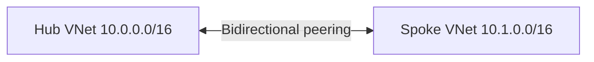
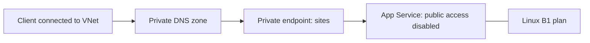
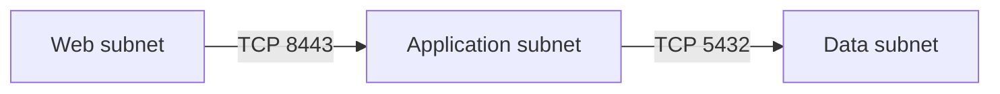

# Architecture labs

## Hub-and-spoke

Start with the catalog's **Hub-and-spoke networking** example.
Expected: two VNets and two connected peerings. Verify each peering state
with `az network vnet peering list`. There is no firewall, gateway, transit,
DNS resolver, or centralized egress. A second spoke would not automatically
reach the first through the hub.

## Private web hosting

Use **Private web hosting** in the [catalog](catalog.md). It composes
the network, subnet, web host, DNS, and endpoint modules.
Verify the endpoint is approved and the app hostname resolves privately from
a connected client. A public browser should not reach it.
Deploy application code separately from an appropriately connected runner.
The example does not provision that runner, VPN, application authentication,
or outbound private access.

## Multi-tier network

Use **Multi-tier network segmentation** for three subnets and NSGs.
Inbound tier traffic is explicitly allowed; other inbound traffic is denied.
The example is intentionally a network foundation, not a running three-tier
application. Review effective NSG rules before attaching real workloads.

All lab README pages include opt-in commands, validation expectations,
prerequisites, costs, and cleanup. No live deployment is part of CI.
