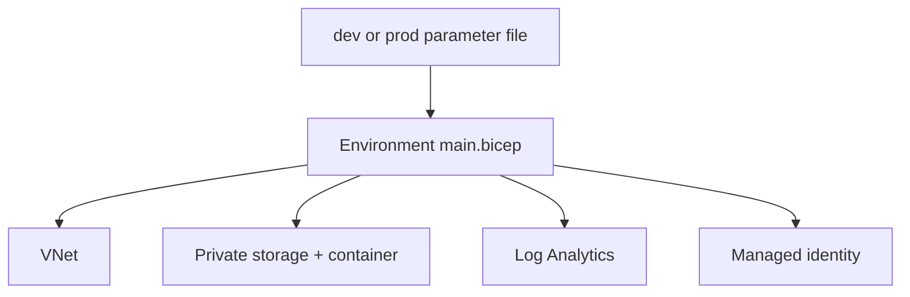

# Project: environment-based infrastructure

**Goal:** deploy consistent building blocks with separate environment inputs
without copying entire templates.

## Components and expected result

The project composes a VNet, private-only storage account and container,
Log Analytics workspace, and user-assigned managed identity.
Names derive from a prefix/environment and deterministic uniqueness.
The `prod` sample changes log retention, not the architecture's availability.



## Source and input file

```bicep title="main.bicep"
--8<-- "13_projects/environment-foundation/main.bicep"
```

```bicep title="dev.bicepparam"
--8<-- "13_projects/environment-foundation/dev.bicepparam"
```

## Compile first

```shell
az bicep build --file 13_projects/environment-foundation/main.bicep --stdout
az bicep build-params --file 13_projects/environment-foundation/dev.bicepparam --stdout
```

## Optional deployment

Use your own `*.local.bicepparam` when regional or organization settings differ.
Create a dedicated resource group for each environment and review scope before
running these Bash commands:

```bash
az deployment group what-if --resource-group "$RG" \
  --parameters 13_projects/environment-foundation/dev.bicepparam
az deployment group create --resource-group "$RG" \
  --parameters 13_projects/environment-foundation/dev.bicepparam
az resource list --resource-group "$RG" --output table
```

Expected: four infrastructure building blocks and a private blob container.
No application data connection is ready: add appropriate endpoints, DNS, and
data roles as a follow-on exercise. Verify that dev and prod use separate
groups, different names, and the intended retention.

## Cleanup and extension

After inspecting the dedicated group, use `az group delete --name "$RG"`.
Retained resources and logs can cost money before deletion completes.
See the catalog module README for more detail.

**Extension:** add a private endpoint and role assignment through modules.
Explain why the project still needs a network-connected test client.
