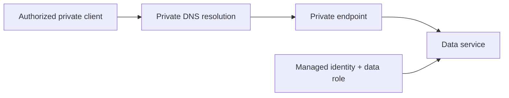

# Security and cost boundaries

## Private by default is not ready to use

Most data-service modules disable public access and local keys. To use them,
you typically need: a private endpoint or delegated subnet, a correctly linked
private DNS zone, a network-connected client, and the correct data-plane role.
Service-specific READMEs state what is missing.

Use HTTPS/TLS, least privilege, managed identities, and scoped deployment
permissions. The resource-group RBAC sample is deliberately broader than a
resource-specific assignment; reduce scope for real workloads.

## Network and runtime checks

- An NSG exists only as a policy object until attached.
- Public access flags do not provide user authentication.
- Private App Service ingress does not configure outbound VNet integration.
- Function host storage needs trigger-specific RBAC and connectivity.
- AKS private administration needs network access and suitable Azure RBAC.
- A Recovery Services vault does not protect anything until backup is configured.

## Cost review before creation

Use the [Azure pricing calculator](https://azure.microsoft.com/pricing/calculator/)
for your region, currency, SKU, retention, and expected traffic.
Premium Service Bus and Elastic Premium Functions have standing charges.
App Service plans, VM disks, public IPs, private endpoints, and logs can cost
money while an application is idle or stopped.

Budgets are alerts, not hard spending caps. Use dedicated groups, ownership
tags, short-lived labs, review dates, and a tested deletion plan.
Do not weaken security to reduce costs without documenting the tradeoff.

## What is not certified

These are educational examples, not security accreditation, a production
landing zone, a guaranteed availability design, or legal/compliance advice.
Review supported APIs, current Azure guidance, your organization's policy,
and region/SKU availability before deployment.
